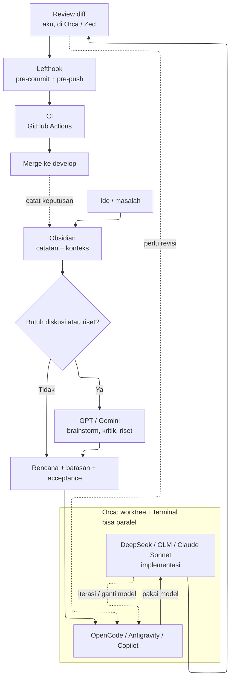

Workflow-ku tidak pernah benar-benar selesai. Dulu cuma buka editor, tulis kode, error, cari jawaban di browser. Sekarang ada Obsidian, Zed, Orca, tiga agen, dan beberapa model. Urutannya masih mirip. Yang berubah: aku harus jauh lebih jelas soal apa yang sebenarnya kuinginkan.

Aku sudah pernah pindah dari CodeVision AVR ke VSCode, JetBrains, lalu Zed. Pelajarannya tetap sama. Tools yang lebih pintar tidak otomatis membuatku jadi developer yang lebih baik. Yang berubah cuma kecepatan aku sampai ke titik "tahu harus ngapain".

Aku tidak sedang mendesain workflow yang sempurna. Ini cuma cara aku menjaga pekerjaan tetap jelas.

## Mulai dari catatan

Sebelum buka editor, aku biasanya sudah punya catatan. Kadang isinya beberapa baris, kadang beberapa halaman. Intinya sama: aku ingin tahu masalahnya dulu.

Kalau proyek kantor punya URD atau PRD, aku baca, tanyakan bagian yang ambigu, lalu mulai. Kalau requirement-nya tidak jelas, aku _brainstorming_ dulu: apa yang dibuat, siapa yang membutuhkan, dan seperti apa hasil yang dianggap selesai. Setelah itu aku minta _acceptance_ dari atasan, kolega, atau stakeholder. Salah paham di awal lebih mahal daripada satu meeting tambahan.

Dari situ aku tulis batasannya:

- apa yang salah,
- siapa yang terdampak,
- hasil yang diharapkan,
- apa yang tidak termasuk.

Kalau aku tidak bisa menjelaskan masalahnya dalam tiga kalimat, biasanya pemahamanku yang belum matang. Proyek seperti blog ini juga gampang melebar. Awalnya cuma benerin spacing, ujungnya refactor komponen dan ganti token warna. Sekarang aku paksa satu sesi kerja punya satu tujuan yang bisa diverifikasi.

## Zed cuma alat

Zed tetap editor utamaku. Bukan karena fiturnya paling lengkap, tapi karena dia tidak sering bikin aku menunggu. File kebuka cepat, pencarian responsif, dan LSP jalan tanpa drama.

Setup-nya minim:

- keymap VSCode, karena muscle memory delapan tahun;
- tab bar dimatikan, project panel di kanan, outline di kiri;
- format on save untuk TypeScript, Astro, CSS, dan Markdown;
- task runner untuk dev, build, type-check, lint, dan test.

Task runner terdengar sepele. Tapi kalau harus mengingat `bun run test:unit:run` setiap kali, cepat atau lambat aku malas.

## Orca: ruang kerja

Begitu pekerjaan melibatkan lebih dari satu _agent_, masalahnya berpindah ke operasional: _worktree_ mana yang aktif, _terminal_ mana yang menjalankan test, perubahan mana yang belum direview.

Orca adalah ADE, singkatan dari Agent Development Environment. Dia ruang kerja untuk mengatur _agent_, _terminal_, dan _worktree_. Zed tetap kupakai untuk menulis dan membaca kode. Orca kupakai untuk mengatur pekerjaan yang berjalan bersamaan.

Untuk kode simpel, aku sering all-in di Orca. Biarkan _agent_ membaca repositori, menulis perubahan, menjalankan test, lalu aku review hasilnya. Selama batasnya jelas, cara ini cepat.

Tapi untuk refactor atau perubahan kompleks, aku perlu membaca kodenya langsung. Kadang tetap di Orca, kadang buka Zed di monitor kedua. Rasanya beda antara "agen bilang ini sudah beres" dan "aku bisa melihat sendiri kenapa ini beres".

Orca tidak menghilangkan kebutuhan disiplin. Kalau worktree berantakan, tools-nya baik-baik saja. Cara aku membagi kerja yang berantakan.

## Obsidian: konteks yang tidak hilang

Aku tidak menyimpan semuanya di kepala. Terlalu banyak keputusan kecil: kenapa satu pendekatan dipilih, apa yang sudah dicoba, apa yang masih menunggu.

Obsidian kupakai untuk mencatat ide dan rencana, menyimpan keputusan beserta alasannya, dan mencari ulang hal-hal yang sudah pernah kupikirkan. Kalau aku pindah _model_ atau _agent_, catatan itu juga jadi tempat mengambil konteks.

Kadang aku mulai dengan satu _model_, lalu sadar pekerjaannya butuh _model_ lain. Atau aku pindah agen karena pekerjaannya berubah bentuk. Kalau semua konteks cuma ada di percakapan, aku harus menjelaskan ulang. Dengan Obsidian, aku mulai dari catatan yang sudah ada.

Obsidian tidak otomatis memahami semuanya. Dia cuma tempat menyimpan hal-hal yang tidak boleh hilang saat aku berpindah alat.

## Model juga punya shift

Aku tidak memakai satu _model_ untuk semua hal. Tiap pekerjaan menuntut hal berbeda: kecepatan, biaya murah, kemampuan membaca konteks panjang, atau lawan berpikir.

| Pekerjaan                                                     | Model         | Alasan praktis                                                         |
| ------------------------------------------------------------- | ------------- | ---------------------------------------------------------------------- |
| Implementasi fitur, refactor terarah, debugging               | DeepSeek      | Cepat, murah, cukup disiplin untuk perubahan yang batasnya sudah jelas |
| Eksplorasi kode, perubahan repetitif, alternatif implementasi | GLM           | Enak untuk kerja yang butuh banyak iterasi kecil                       |
| Perubahan multi-file, review kode, konteks panjang            | Claude Sonnet | Lebih sabar membaca hubungan antar file dan menjelaskan trade-off      |
| Diskusi rencana, kritik keputusan, bantu nulis                | GPT           | Cocok untuk diajak berdebat sebelum kode ditulis                       |
| Riset, baca dokumen panjang, eksplorasi ide                   | Gemini        | Membantu waktu aku butuh memahami konteks yang lebih luas              |

Ini preferensi pribadi, bukan benchmark. Model coding untuk mengeksekusi, model diskusi untuk berpikir. Kalau dicampur, hasilnya sering mahal tapi tidak lebih jelas.

Aku juga tidak selalu setia. DeepSeek sering cukup. Untuk perubahan yang menyentuh banyak file, aku pilih Claude Sonnet. Kalau ingin berdebat dulu, GPT. Urutannya tetap: diskusi dulu, baru eksekusi.

Aku sempat menggambar agen dan model sebagai tahap setelah Orca. Itu kurang tepat. Keduanya berjalan di dalam Orca. Kadang satu agen memakai satu model berurutan, kadang beberapa worktree jalan paralel dengan agen dan model berbeda. Orca yang menjaga pekerjaan tetap terpisah.

Diagram tidak berhenti di merge. Catatan setelah merge masuk lagi ke Obsidian, jadi putaran berikutnya dimulai dari konteks yang sudah diperbarui. Obsidian jadi titik awal sekaligus tempat pulang. Keputusan penting juga kucatat saat terjadi, bukan menunggu semuanya selesai.

Praktiknya sering mundur. Hasil implementasi bisa membuatku sadar rencananya salah, lalu aku kembali ke GPT atau Gemini. Itu bagian normal dari kerja.

## Konteks lebih mahal daripada prompt

Dulu aku sering menulis prompt panjang tentang struktur proyek. Hasilnya tetap meleset, karena agen hanya tahu apa yang kuceritakan, tidak isi repo.

Sekarang konteksnya tinggal di repo:

- `docs/` berisi design system, component inventory, dan panduan Astro;
- `AGENTS.md` berisi aturan kerja dan urutan pencarian;
- graph codebase dipakai untuk mencari fungsi, melacak pemanggil, dan membaca potongan kode;
- konfigurasi editor dan task runner ikut tersimpan.

Agen tidak perlu menebak. Dia mulai dari peta yang sudah ada.

Graph dan dokumentasi bisa salah. Graph punya celah, dokumentasi bisa basi, nama fungsi bisa menipu. Kalau hasil pencarian terasa aneh, aku buka file aslinya. Sepuluh baris kode yang tepat lebih cepat daripada ringkasan yang salah.

## Agen bukan autocomplete

Aku memakai tiga agen dengan peran berbeda.

OpenCode untuk kerja terminal-first: membaca repo, menjalankan perintah, menulis perubahan, menjalankan test. Antigravity saat pekerjaan butuh eksplorasi visual atau browser. Copilot untuk hal kecil di editor: autocomplete, potongan fungsi, perubahan yang tidak perlu sesi agen penuh.

Pembagian ini bisa berubah. Kadang aku mulai di Copilot, sadar perubahannya lebih besar, lalu pindah ke OpenCode. Kadang Antigravity cuma kupakai untuk memastikan tampilan di browser sesuai. Yang penting, pekerjaannya cukup jelas untuk diserahkan.

Aku tidak menyerahkan keputusan arsitektur, penamaan domain, dan review akhir. Agen sebenarnya bisa. Tapi kalau aku tidak paham keputusannya, aku tidak bisa mempertanggungjawabkannya enam bulan kemudian.

Aturan operasionalnya ketat:

- perintah read-only seperti `git status`, `grep`, `ls` boleh jalan;
- commit, push, hapus file tetap minta konfirmasi;
- agen tidak boleh merge ke branch utama;
- setiap perubahan lewat branch sendiri.

Branch terpisah membuat perubahan mudah dibandingkan, diuji, dan dibatalkan. Kalau ada yang salah, aku tidak perlu menyelam ke history.

## Verifikasi berlapis

Aku tidak lagi mengandalkan "ah, kayaknya jalan". Sekarang ada beberapa lapisan.

### Editor

Format on save dan lint otomatis menangani spasi, urutan import, tanda kutip. Ini mengurangi noise di diff, bukan menggantikan berpikir.

### Git hooks

Lefthook menjalankan Biome dan Prettier untuk file yang berubah, lalu `astro check`. Saat push, unit test jalan. Kadang commit tertahan karena error lama yang sudah ada sebelumnya. Aku tetap pertahankan, karena lebih baik tertahan di laptop daripada ketahuan di CI.

### CI

GitHub Actions menginstall dependency dengan Bun, lint dan format check, type-check, build, unit test, lalu E2E Playwright termasuk visual dan aksesibilitas. Untuk perubahan konten murni, CI tidak selalu jalan karena `paths-ignore`. Untuk kode, semua harus hijau.

### Mata manusia

Test bisa hijau tapi tampilan tetap aneh. Aku tetap buka preview, cek mobile, dan lihat apakah layout geser. Playwright menemukan regresi visual. Dia tidak bisa menilai apakah desainnya terasa benar.

Sesekali aku menjalankan analisis kode untuk mencari export tidak terpakai, dependency berlebih, atau duplikasi. Aku tidak menghapus semuanya. Kode yang tidak pernah dipakai sering menyembunyikan keputusan lama.

## Rilis membosankan

Setelah lolos verifikasi:

- branch `feat/`, `fix/`, atau `post/`;
- conventional commits;
- pull request ke `develop`;
- semantic-release menentukan versi dan changelog;
- merge ke `main` memicu rilis.

Tidak ada langkah ajaib. Tidak ada deploy manual dari laptop. Semakin membosankan, semakin kecil kemungkinan aku lupa satu langkah.

## Yang tidak kuserahkan

Agen bisa menulis 300 baris dalam satu menit. Tapi kalau aku tidak bisa menjelaskan kenapa 300 baris itu ada, apa yang dia pecahkan, dan apa yang mungkin rusak, itu cuma teks yang kebetulan lolos test.

Aku tetap membaca diff. Aku bertanya kenapa fungsi ini ditaruh di sini, kenapa nama ini dipilih, apakah ada cara yang lebih sederhana. Jawaban "karena pola yang sudah ada memang begitu" sering cukup. Pola yang konsisten lebih mudah dirawat.

Ganti model tidak mengubah kebutuhan itu. Model lebih mahal bisa memberi jawaban lebih panjang, belum tentu keputusan lebih benar. Yang menentukan tetap pemahamanku dan apakah perubahannya bisa diuji.
